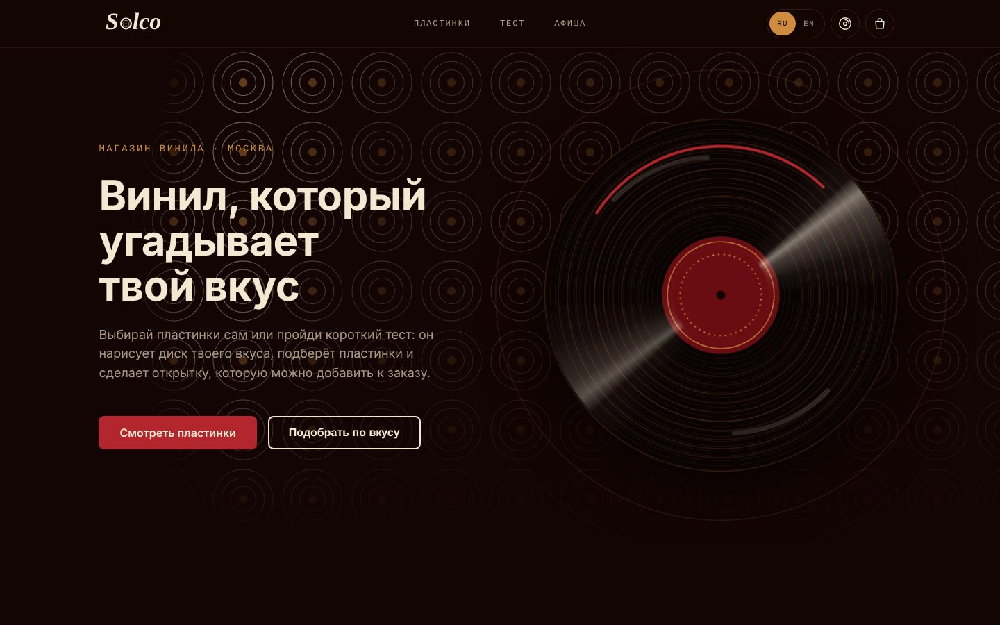
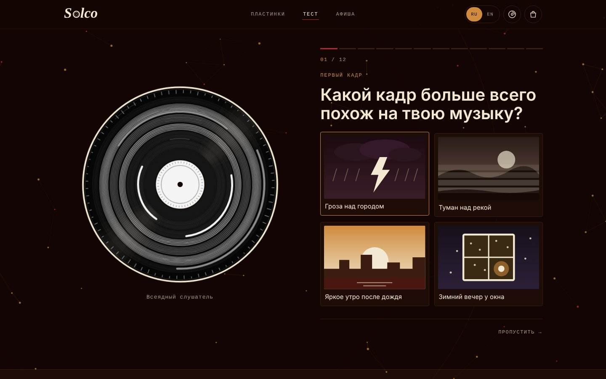
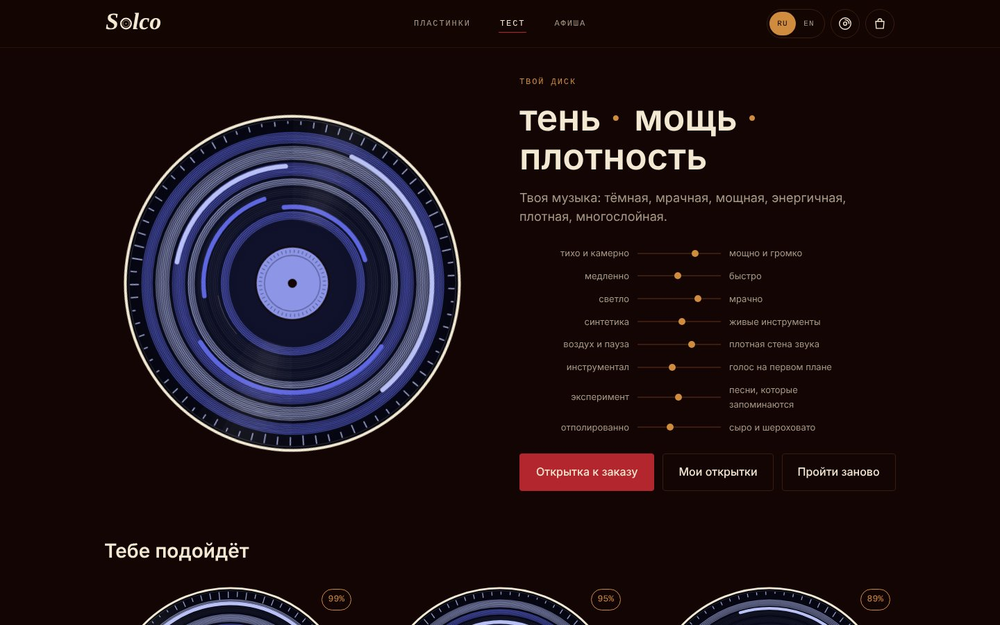
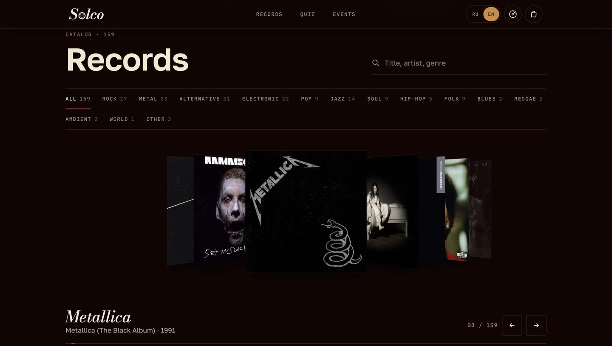
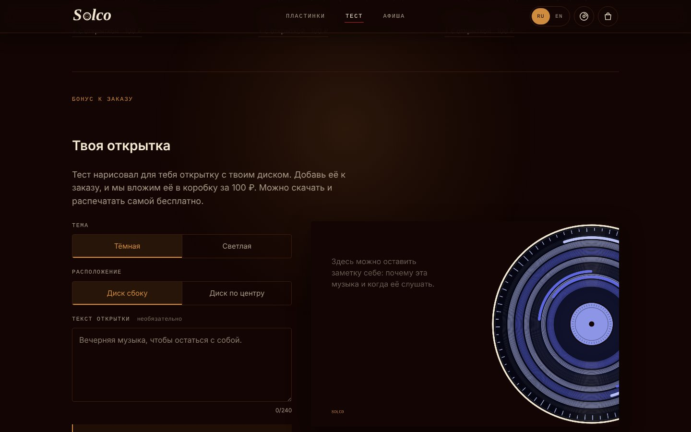
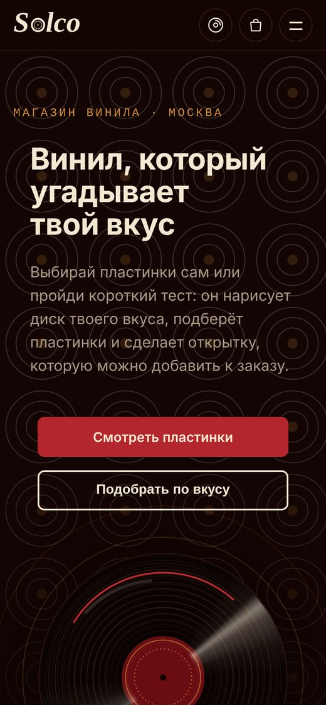

# Solco — магазин винила с диском вкуса

Учебный fullstack-проект: интернет-магазин виниловых пластинок. Можно просто выбрать пластинки в каталоге, а можно пройти короткий тест: он нарисует **диск вкуса**, подберёт пластинки с процентом совпадения и сделает **открытку**, которую можно добавить к заказу.

<p align="center">
  
</p>

**Живой сайт:** [vinyl-store-fr-bck.vercel.app](https://vinyl-store-fr-bck.vercel.app) · интерфейс на русском и английском, тёмная тема «Погреб» и светлая «Бумага».

Дизайн-кейс (айдентика, мудборд, гайд) лежит отдельно, в папке `VinylDNA-case`.

## Что внутри

- **Каталог.** 159 пластинок, полка конвертов с прокруткой и окном пластинки, жанры, поиск. Порядок на полке случайный, но популярные (по бейджам «Хит», «Бестселлер» и т. п.) идут первыми.
- **Тест вкуса.** 12 вопросов (на каждом есть «Пропустить»), 8 осей вкуса, живой диск и интерактивный фон. Подбор считается на сервере (`backend/utils/tasteEngine.js`).
- **Диск вкуса.** Генерируется в SVG по осям (`frontend/src/utils/tasteDisc.js`).
- **Открытка.** Конструктор на canvas, 15×10 см, 300 dpi: тёмная и светлая темы, два расположения, режим «для себя» и «в подарок». В заказе стоит 100 ₽, PNG можно скачать бесплатно.
- **Мои открытки.** Каждый тест сохраняется в профиле вместе с открыткой и подборкой.
- **Корзина и оформление заказа.** Открытку можно убрать прямо из корзины.
- **Афиша Solco Live.** События с записью (данные в `frontend/src/data/events.js`).
- **Избранное, регистрация и вход.** JWT, пароли хешируются (bcrypt).

Избранное, результаты теста, открытки и записи на события хранятся в браузере (`localStorage`), вход для них не нужен.

## Как это выглядит

| Тест вкуса | Результат: диск и подбор |
|---|---|
|  |  |
| **Каталог** (полка конвертов, жанры, поиск) | **Открытка к заказу** (конструктор на canvas) |
|  |  |

<p align="center">
  
</p>

## Стек

- **Frontend:** React 19 (Create React App), Context API, Axios, чистый CSS. Страницы переключаются состоянием в `App.js`, без роутера.
- **Backend:** Node.js, Express, JWT, bcryptjs, Swagger (`/api-docs`).
- **Данные:** JSON-файлы в `backend/data` (пластинки, пользователи, модель и вопросы теста).

## Запуск

Нужен Node.js 18 или новее.

```bash
# бэкенд, порт по умолчанию 3000
cd backend
npm install
npm start

# фронтенд, в другом терминале
cd frontend
npm install
REACT_APP_API_URL=http://localhost:3000/api npm start
```

На macOS можно запускать `start-backend.command`, `start-frontend.command` и `stop-servers.command` двойным кликом.

Проверка модели теста: `node backend/scripts/taste_validate.js`.

## API

| Метод | Адрес | Что делает |
|---|---|---|
| GET | `/api/products` | список пластинок |
| GET | `/api/products/:id` | одна пластинка |
| GET | `/api/taste/questions` | вопросы и оси теста |
| POST | `/api/taste/result` | профиль и рекомендации по ответам |
| POST | `/api/auth/register`, `/api/auth/login` | регистрация и вход |
| GET | `/api/auth/me` | текущий пользователь (по токену) |

Полная документация: `/api-docs`.

## Структура

```
backend/
  app.js            сервер и маршруты каталога
  routes/           auth, taste
  utils/            tasteEngine: расчёт профиля и подбор
  data/             products.json, taste_*.json, users.json
frontend/src/
  pages/            Home, Taste, Profile, Events, Solco (о магазине), Login, Register
  components/       CrateShelf, GiftCard, HeroDisc, TasteBg, Cart, Header, ...
  utils/            tasteDisc (диск), discs (сохранённые тесты), popularity (порядок полки)
  context/          Cart, Favorites, Auth
```

## Заметки

- Это учебный проект: заказы и записи на события никуда не отправляются, деньги не списываются.
- Фото в афише (`frontend/public/assets/events`) взяты из мудборда как временные, перед публикацией их стоит заменить на свои или лицензионные.
